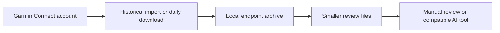

# How the data moves

This is runnable Windows pilot source, not a hosted dashboard. Each person uses their own Garmin account and stores their own data on their computer.

The daily task ends at local files. It does not automatically send anything to an AI provider, the author, or a website. Opening those files with an AI application is a separate choice governed by that application’s settings.

## Example output

See [examples/illustrative-output.json](examples/illustrative-output.json) for a deliberately small, synthetic illustration. It contains no real athlete data and is not a byte-for-byte schema fixture. The test suite shows mocked endpoint responses and the actual processing logic.

The full workflow preserves available workout detail, laps, splits, effort/feeling values and selected sleep/HRV summaries. Missing data remains unknown. A completed download does not guarantee that every metric was available or that the watch uploaded its newest workout.

## My role

I developed this personal project with Python and Codex, using AI assistance to turn a training-data organization problem into a repeatable local workflow. The work includes requirements, iteration, local checks, documentation, and a Windows starter package.

## Limits

The included installer has passed local offline checks. End-to-end testing on a fresh computer is still pending. The project uses an unofficial third-party Garmin client and is not endorsed by Garmin. It organizes data; it does not independently prescribe training.
